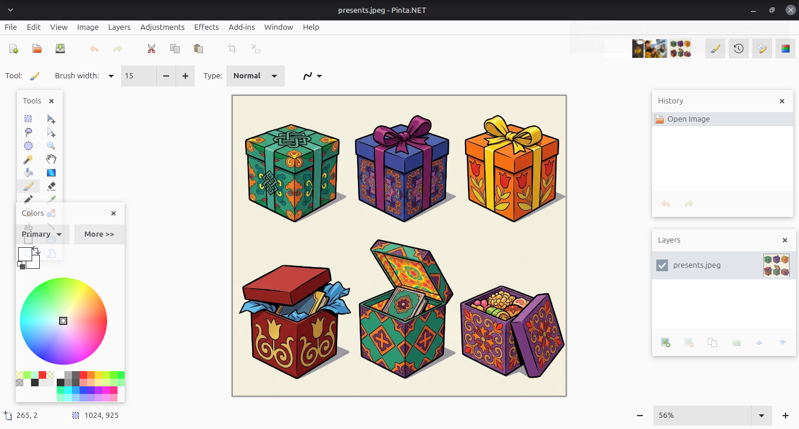

# Pinta Classic Workflow

**Pinta Classic Workflow** is a fork of [Pinta](https://github.com/PintaProject/Pinta) whose single goal is to make the look and behavior of the editor as close as possible to [Paint.NET](https://www.getpaint.net/) — the classic menu bar, floating tool windows, colored icons, the color wheel and all the small habits Paint.NET users rely on.



It is **not** the official Pinta application. Please report bugs and ask questions in [this repository](https://github.com/ta3map/Pinta-Classic-Workflow/issues), not on the upstream Pinta trackers.

## Origin

Pinta Classic Workflow is a fork of [Pinta](https://github.com/PintaProject/Pinta) — the open source GTK clone of Paint.NET 3.0 by Jonathan Pobst and Pinta contributors — maintained by [ta3map](https://github.com/ta3map). It installs alongside the original Pinta, keeps its own settings and works with add-ins made for Pinta.

## Install

Download the packages from the [Releases](https://github.com/ta3map/Pinta-Classic-Workflow/releases) page.

**Flatpak** (any Linux distribution):

```bash
flatpak remote-add --user --if-not-exists flathub https://flathub.org/repo/flathub.flatpakrepo
flatpak install --user PintaClassicWorkflow.flatpak
flatpak run io.github.ta3map.PintaClassicWorkflow
```

**Debian / Ubuntu** (Debian 13, Ubuntu 25.04 or newer — requires GTK >= 4.18 and libadwaita >= 1.7):

```bash
sudo apt install ./pinta-classic-workflow_<version>_amd64.deb
pinta-classic-workflow
```

## Differences from the latest Pinta

**Window layout**
- Classic menu bar (File, Edit, View, Image, Layers, Adjustments, Effects, Add-ins, Window, Help) instead of header bar buttons and hamburger menus.
- Colored icons next to every menu item, as in Paint.NET.
- Tools, Colors, History and Layers are floating, semi-transparent windows over the canvas instead of docked side panels. They can be moved by their title, resized by their edges, and remember position and size.
- Each window can be shown or hidden from View, with F5–F8, or with toggle buttons on the main toolbar.
- Open images are shown as a thumbnail strip on the main toolbar instead of tabs.
- Zoom controls sit in the bottom right corner of the status bar.
- Flat, square-cornered widgets in the spirit of Windows 7 instead of rounded libadwaita styling.

**Icons**
- Colorful icons from Pinta 1.3 for tools, adjustments, effects, image, layer and view commands.
- Tango-style icons (from the Humanity theme) for New, Open, Save, Undo, Redo, Cut, Copy, Paste and other standard commands, instead of monochrome symbolic icons.

**Tools**
- Fixed two-column tool order of Paint.NET: rectangle select / move selected, lasso / move selection, ellipse select / zoom, magic wand / pan, paint bucket / gradient, paintbrush / eraser, pencil / color picker, clone stamp / recolor, text / line, shapes.
- Drop-down lists of standard sizes next to every size field (brush width, font size and so on).

**Colors**
- Paint.NET-style Colors window: primary / secondary selector, color wheel, primary and secondary swatches with swap and reset, and a compact two-band palette.
- **More >>** expands the window with hex, HSV and RGB fields and a transparency (alpha) slider.

**Behavior**
- **Esc** deselects.
- **Ctrl+F** repeats the last effect, and the menu item shows which effect will be repeated.
- Layers can be reordered by drag and drop.
- **File > Open Recent** lists the last opened and saved files.
- Paint.NET **.pdn** files can be opened.
- *New Screenshot* was removed from the File menu.

## Building

Requirements: .NET 8 SDK, GTK >= 4.18 and libadwaita >= 1.7.

```bash
dotnet build
dotnet run --project Pinta
```

If your distribution ships older GTK / libadwaita, build and run inside the GNOME Flatpak SDK:

```bash
flatpak install flathub org.gnome.Sdk//48 org.freedesktop.Sdk.Extension.dotnet8//24.08
dev/build.sh   # builds into build/bin
dev/run.sh     # runs build/bin/Pinta.dll
```

Platform-specific instructions for Windows (MSYS2) and macOS (Homebrew) are the same as for [upstream Pinta](https://github.com/PintaProject/Pinta#readme).

## License

The code is licensed under the MIT License, see [`license-mit.txt`](license-mit.txt).

Code from Paint.NET 3.36 is used under the MIT License and keeps the original headers on source files. See [`license-pdn.txt`](license-pdn.txt) for Paint.NET's original license.

### Icons

- [Paint.NET 3.0](https://www.getpaint.net/) — MIT License.
- [Silk icon set](https://github.com/markjames/famfamfam-silk-icons) — [CC BY 3.0](https://creativecommons.org/licenses/by/3.0/).
- [Fugue icon set](https://p.yusukekamiyamane.com) — [CC BY 3.0](https://creativecommons.org/licenses/by/3.0/).
- [Humanity icon theme](https://launchpad.net/humanity) — GNU GPL v2. Used for the `toolbar-*.svg` icons, see [`license-humanity-icons.txt`](license-humanity-icons.txt).
- Pinta contributors — same license as the project (see `Pinta.Resources/icons/pinta-icons.md`).
